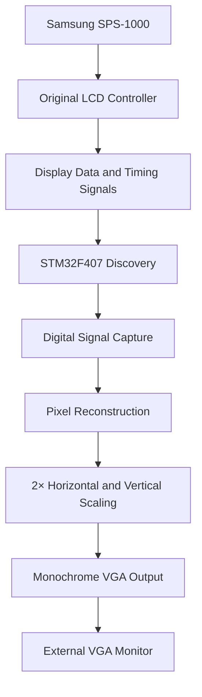

# OpenDisplayBridge

### Reconstructing Legacy Displays with Microcontrollers

OpenDisplayBridge is an open-source hardware reverse-engineering project that explores how existing digital display signals can be captured, reconstructed, and converted into modern display formats.

Using the Samsung SPS-1000 cash register as a working example, the project demonstrates real-time capture of a 320×240 monochrome display interface and reconstruction as 640×480 VGA using an STM32F407.

The goal is to share reusable techniques for engineers, makers, and repair enthusiasts who want to understand, recover, or adapt displays from legacy embedded systems.

**One display recovered. Techniques others can reuse.**

# Samsung SPS-1000 Live Display Reconstruction Using STM32F407

**Reconstructing a live 320×240 monochrome LCD display as 640×480 VGA using an STM32F407 Discovery board.**

## Project Overview

This project explores the reconstruction of the original display output of a Samsung SPS-1000 electronic cash register using an STM32F407 Discovery board.

The original Samsung LCD is still connected to the cash register. The STM32F407 captures the display signals and reconstructs the image for output to an external VGA monitor.

The VGA monitor displays the **real-time interface generated by the original Samsung system**, including its menus, text, and selection highlighting. The STM32F407 does not need to recreate the cash register's software or draw a simulated interface.

The project demonstrates how a microcontroller can capture an existing digital display stream and convert it into a format suitable for a different display.

## Demonstration

The external VGA monitor displays the live Samsung SPS-1000 interface, including the X-MODE Manager Menu.

The original system remains operational, and the VGA output follows the original display as the system runs.

The display has also been tested after restarting the cash register and performing a factory reset.

## Hardware

- **Target system:** Samsung SPS-1000 electronic cash register
- **Original display controller:** SED1351FOA
- **Capture and reconstruction platform:** STM32F407 Discovery
- **Output display:** VGA monitor
- **Original display resolution:** 320×240 monochrome
- **Reconstructed VGA resolution:** 640×480 monochrome

## System Architecture

The Samsung continues to generate the original interface. The STM32F407 captures the display information, reconstructs the image, and outputs it to VGA.

## Video Reconstruction Pipeline

### 1. Capture the Display Signals

The STM32F407 captures the display data and synchronization signals from the original display interface.

The implementation uses STM32 peripherals and direct register configuration to coordinate signal capture and memory transfers.

The capture logic is designed to preserve the relationship between pixel data, the pixel clock, horizontal synchronization, and vertical synchronization.

### 2. DMA-Based Acquisition

DMA is used to transfer sampled GPIO data into memory with reduced CPU overhead.

The capture implementation uses the STM32F407's hardware peripherals to support repeated sampling and line-based frame reconstruction.

Synchronization handling identifies line and frame boundaries so the captured data can be organized into an image.

### 3. Pixel Reconstruction

The captured display data is processed into a monochrome framebuffer.

Lookup tables accelerate pixel expansion, avoiding the need for expensive per-pixel calculations.

### 4. Resolution Scaling

The original display is 320×240 pixels. The reconstructed output is scaled to 640×480 VGA by doubling the image dimensions horizontally and vertically.

Each source pixel is represented by a 2×2 block of output pixels.

This nearest-neighbor scaling preserves the original pixel-art appearance and makes the image suitable for a standard VGA monitor.

### 5. VGA Output

The reconstructed monochrome framebuffer is sent to the VGA output engine running on the STM32F407.

The result is a live external display of the Samsung's original interface.

## Development and Debugging

Before connecting the capture system to the original Samsung hardware, an ESP32 was used to generate a controlled 4-bit parallel video stream with pixel clock, HSYNC, and VSYNC.

This test setup allowed the STM32F407 capture and VGA reconstruction pipeline to be developed independently.

During testing, a moving black line revealed synchronization instability. Experiments with DMA transmission and VSYNC behavior helped isolate the timing problem and improve image stability.

Once the test pipeline was working, the project progressed to capturing the actual Samsung display signals.

The ESP32 test generator was a development tool; the final objective is to reconstruct the real Samsung display output.

## Current Status

**Working proof of concept — live display reconstruction demonstrated.**

- [x] Generate a parallel video test stream using an ESP32.
- [x] Capture digital video signals with the STM32F407.
- [x] Reconstruct a monochrome VGA image.
- [x] Scale the original 320×240 image to 640×480.
- [x] Display the Samsung SPS-1000's actual interface on an external VGA monitor.
- [x] Verify operation after restarting the Samsung system.
- [x] Verify operation after a factory reset.
- [ ] Further document the complete signal mapping and timing.
- [ ] Publish detailed wiring diagrams and capture timing measurements.

## Why This Project Matters

This project demonstrates a practical approach to extending the life of legacy embedded hardware by reconstructing its display output with a modern microcontroller.

Instead of replacing the original cash register or recreating its user interface, the STM32F407 acts as a bridge between the existing display subsystem and a standard VGA monitor.

The project combines:

- Embedded C/C++ programming
- STM32 register-level development
- GPIO sampling
- Timer and DMA configuration
- Digital video synchronization
- Framebuffer processing
- Monochrome VGA generation
- Hardware reverse engineering

## Conclusion

The Samsung SPS-1000 continues to run its original software while the STM32F407 reconstructs its live display on an external VGA monitor.

This project demonstrates how careful use of microcontroller peripherals, DMA, and framebuffer processing can make it possible to interface legacy display hardware with a modern output device.

**Original hardware. Original software. Live display reconstruction. Powered by STM32F407.**
